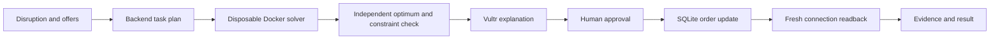
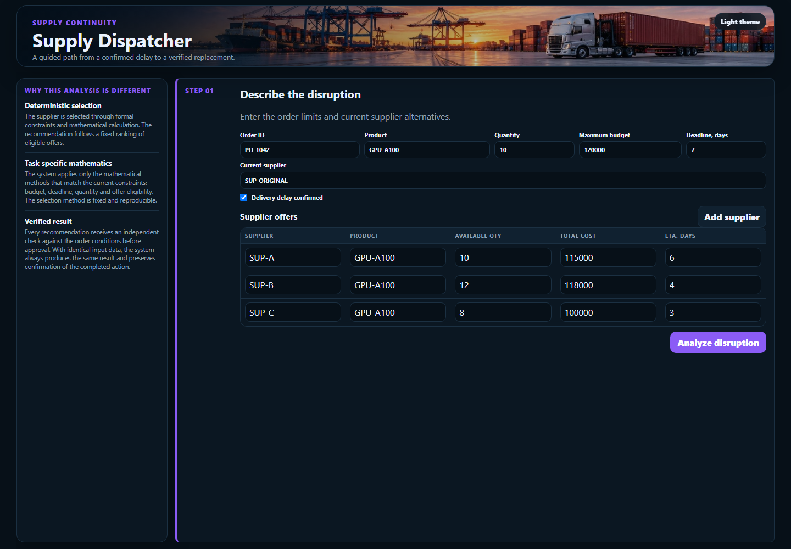
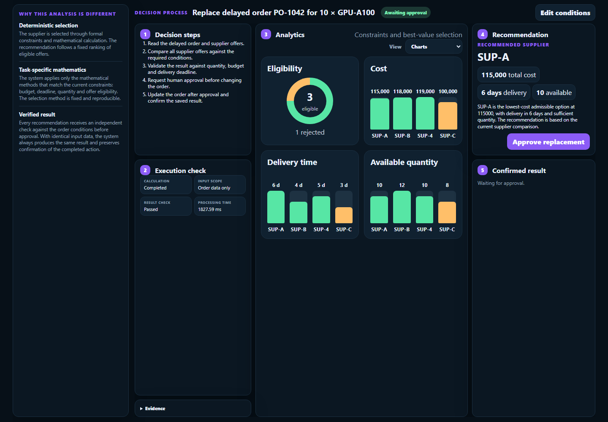
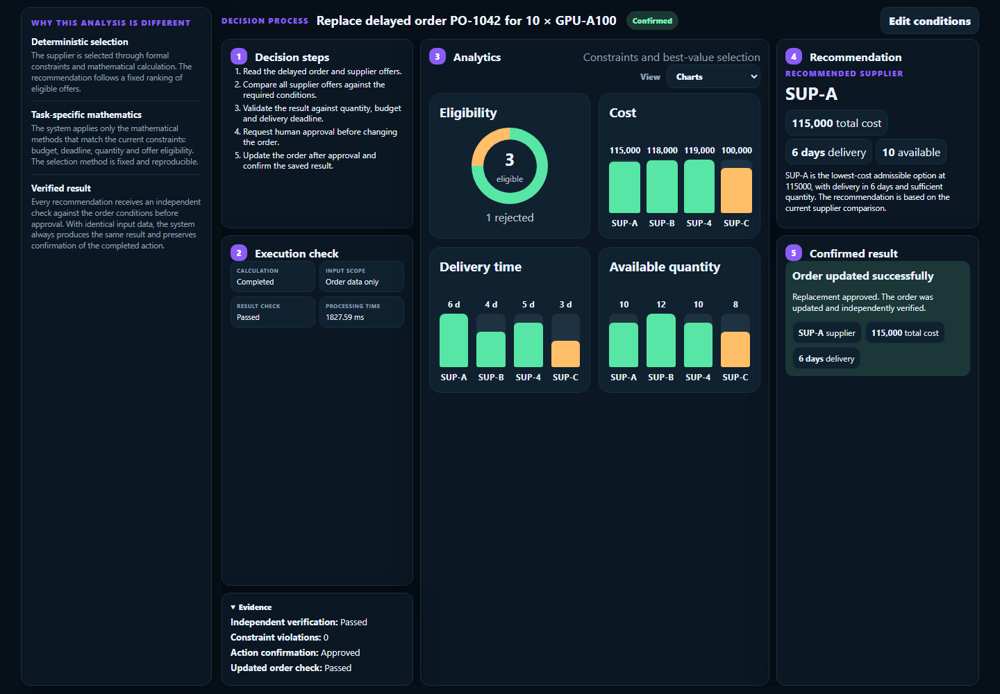

# Supply Dispatcher

Recover a disrupted supply order with a deterministic supplier recommendation, human approval and a verified, durable update.

## Problem and solution

A delivery delay forces a buyer to compare price, available quantity, product match and delivery dates under time pressure. A fluent explanation alone cannot establish feasibility or prove that an order changed.

Supply Dispatcher runs a constrained supplier comparison in a disposable execution environment, checks the result with a separate oracle, asks for approval, updates its SQLite order ledger, and independently reads back the committed result. The application handles synthetic procurement orders. It does not place real supplier orders or connect to an ERP.

## User workflow

1. Enter the current order and supplier, confirm the disruption and review alternative offers.
2. Select **Analyze disruption**. Review the planned decision steps, offer comparison and recommendation.
3. Change the Analytics **View** between **Table**, **Metrics** and **Charts**.
4. Select **Approve replacement**. The app saves the replacement and confirms the persisted supplier, cost and delivery date.
5. Expand **Evidence** to review the outcome checks. No order changes before approval.

Only the selected third interface is included. The original five-interface working project, databases and private reference documents are outside this release.

## Architecture



The backend owns state transitions and approval. The isolated task receives only an input JSON file and the fixed public solver. No model-generated code or arbitrary browser actions run on the host. A changed event invalidates pending proposals. A complete request fingerprint identifies the decision. Repeated approval of the same saved result creates no second update or success record.

## Mathematical deterministic supplier selection

An offer is eligible exactly when its product matches, available quantity covers the order, total cost does not exceed the budget, and ETA does not exceed the deadline. Among eligible offers, minimize `(total_cost, eta_days, supplier_id)` lexicographically. The supplier ID breaks exact ties. If none qualifies, report the conflicting conditions and leave the order unchanged.

The existing finite optimization objective is preserved. Inputs reject non-finite costs, fractional quantities/ETAs, negative offer values and duplicate supplier IDs. Costs use the original finite floating-point model. Monetary accounting with currency rounding would require a separate contract.

## Verification and evidence

The host oracle scans candidates with explicit pairwise comparisons and imports no optimizer or sandbox code. It verifies the returned optimum and status. Approval checks the selected constraints again. A separate SQLite connection reads the committed order before the app records verification. The trace records proposal and verified result, with the task run ID and a SHA-256 hash of the sandbox output. Hashes support artifact matching, not cryptographic attestation of a remote host.

`GET /api/order/{order_id}` returns the durable order record. `GET /api/trace/{decision_id}` returns technical evidence for operators. Technical logs and internal status identifiers are not shown in the product UI.

## Experience reuse and applicability

Only a verified success enters experience storage. Reuse requires the same product, the saved supplier still among currently eligible offers, a quantity no larger than the successful case, sufficient budget and sufficient deadline. The current deterministic optimum must also agree with that supplier. Experience can skip a redundant LLM explanation, but never bypasses current calculation, approval or verification. No speedup or business outcome is claimed from this functional mechanism.

## Vultr infrastructure and inference

Deployment target: a Vultr VM running this backend, Docker and Caddy for HTTPS. All LLM calls use the OpenAI-compatible `https://api.vultrinference.com/v1/chat/completions` endpoint. The LLM explains an already verified selection and cannot choose or update the supplier. Model credentials stay in the backend environment. Applicable experience may avoid an LLM call.

Production startup requires an inference key, model and Docker backend. Production inference failures fail the request rather than silently falling back. Local development without credentials uses a deterministic English explanation and does not count as a verified Vultr integration.

**Public demo URL:** not provisioned. **Vultr VM and live inference:** blocked pending account/VM access and inference credentials. No cloud deployment is claimed by local test results.

## Sandbox and containment

Docker runs each fixed solver in a new container with network disabled, a read-only root, all capabilities dropped, no-new-privileges, 128 MiB RAM with no additional swap, 0.50 CPU, 64 PIDs and a four-second CPU limit. The host applies an eight-second wall-clock limit. Only the task's temporary directory is mounted. App environment variables, databases, source directories and the Docker socket are never mounted into a task. The runner removes the named container in a `finally` block, including on timeout, and removes the temporary work directory.

The official Python image contains a public `GPG_KEY` used to authenticate Python releases. This is not an application secret. The containment test plants an application-key sentinel in the host environment and confirms it is absent inside the task.

Docker shares the host kernel and is not a VM-grade security boundary. The trusted backend's Docker access is privileged. Use a dedicated VM with synthetic demo data. The public app has shared state and no tenant authentication. It is a competition demonstration, not a production procurement system.

The optional `SANDBOX_BACKEND=local` mode uses a fresh Python subprocess with a minimal environment. It has **no resource or network containment guarantee** and must not be used for competition deployment.

## Installation and local run

Requirements: Python 3.11+, Docker Engine/Desktop and the `python:3.13-slim` image. The runtime uses the Python standard library.

```bash
git clone https://github.com/CAPEXNULL/Vultr-Dispatcher.git
cd Vultr-Dispatcher
docker pull python:3.13-slim
python app.py
```

Open `http://localhost:8003/`. If this port is occupied by an earlier local preview, use `PORT=8013` for an independent check or stop the earlier preview yourself. Docker is the default when the executable is available. A missing or stopped daemon causes a clear analysis failure rather than executing a task in the application process.

PowerShell development configuration:

```powershell
$env:SANDBOX_BACKEND='docker'
$env:PORT='8003'
python app.py
```

The application does not auto-load `.env`. Set environment variables in the shell or use the protected systemd EnvironmentFile for deployment.

## Environment variables

| Variable | Purpose / default |
| --- | --- |
| `VULTR_SERVERLESS_INFERENCE_API_KEY` | Backend-only inference credential |
| `VULTR_MODEL` | Model ID from the live Vultr catalog |
| `REQUIRE_VULTR_INFERENCE` | `1` for production, `0` for local development |
| `SANDBOX_BACKEND` | `docker` for deployment, `local` only for development |
| `SANDBOX_IMAGE` | `python:3.13-slim`, pin its digest for deployed reproduction |
| `PORT` | `8003` |
| `BIND_HOST` | `127.0.0.1` |
| `DISPATCHER_DB` | `dispatcher.db` in the application directory |

## Tests and reproducibility

```bash
python -m pip install -r requirements.txt
python -m pytest -q --junitxml=reports/acceptance.xml
python containment_demo.py
```

See [TEST_PLAN](TEST_PLAN.md), [test evidence](reports/) and [deployment instructions](deploy/DEPLOYMENT.md). The suite includes exactly 299 generated fresh-state workflow cases with an independent oracle, plus regressions, HTTP checks and real Docker containment tests. Those 299 functional cases use isolated local Python subprocesses, while the separate Docker tests establish actual containment. A passing local suite does not establish public HTTPS availability or live Vultr use.

To reproduce, clone into an empty directory, install the test dependency, pull the documented image, and run the same commands. No local databases or credentials are distributed. Tests use fresh temporary databases.

## Screenshots





## Demo scenario

Order `PO-1042` needs 10 GPU-A100 units within seven days, budget 120,000. Current supplier `SUP-ORIGINAL` is delayed. SUP-A offers 10 units for 115,000 in six days. SUP-B offers 12 units for 118,000 in four days. SUP-C offers eight units for 100,000 in three days. SUP-C fails quantity. SUP-A wins the declared lowest-cost objective despite SUP-B's earlier ETA. After approval the saved order references SUP-A. The sample leaves 5,000 of the budget unused. This is a synthetic example, not a measured customer saving.

## Submission materials

[Video script](VIDEO_SCRIPT.md), [submission fields](SUBMISSION.md), [pitch deck](output/pdf/Supply-Dispatcher-Pitch.pdf), [architecture](docs/ARCHITECTURE.md), [competition requirements](docs/COMPETITION.md) and [deployment guide](deploy/DEPLOYMENT.md). The recorded video and live demo must be completed before final submission.

## Technologies and license

Python, SQLite, Docker, HTML, CSS, JavaScript, Vultr Serverless Inference, Vultr Cloud Compute and Caddy. MIT license applies only to this standalone release. Private reference materials and other projects are not part of the repository. Third-party components retain their own licenses.
